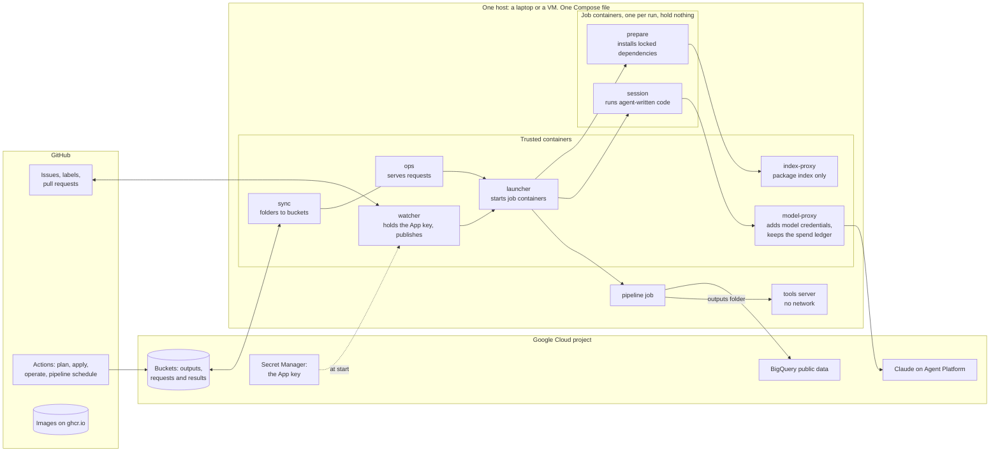

# Round 2 plan: the container stack

**Status:** approved by the owner on 2026-11-24.

One Compose file runs the watcher, agent sessions, the data pipeline and the tools server the
same way on a laptop and on a cloud VM. Google Cloud is the first cloud host. After phase 2 the
laptop can be off.

Every price, flag and service below was checked against current documentation on 2026-11-24.
Section 9 lists the sources and section 10 lists what could not be confirmed.

## Decisions for the owner

Approving the plan as written accepts every recommendation in this table.

| # | Decision | Recommendation | Why |
|---|---|---|---|
| 1 | Which model to pin | `claude-opus-5-5` on the global endpoint | It keeps 30 tasks under $75. Fable 5.2 costs twice as much per token and needs extra sign-up steps on Google Cloud. Details in section 7. |
| 2 | Phase 1 spends about $2 to $5 on the Google Cloud project | Accept | The kickoff says nothing is spent until phase 2. That can't hold: a real task through Compose on the laptop is a real model call, and the only model route this round is Agent Platform. No VM, bucket or other resource is created in phase 1. |
| 3 | A container runtime on the laptop | Try Apple's `container`, already installed, as the Linux machine that Docker Engine runs in. If the one-hour trial fails, install Docker Desktop or any other Docker Engine 28 or newer | Apple's tool can't run the Compose file itself: it has no Compose and no Docker interface, and three of the session's walls aren't documented for it. Inside one of its Linux machines, Docker Engine would be the same engine the cloud VM runs. Details in section 3. |
| 4 | Four small changes to task-agent, about 30 of its 93 spare lines | Accept | Without them a session can't be started in another container or pinned to a model. Listed in section 11. The 2,000-line cap stays. |
| 5 | Who creates the budget and its alerts | The bootstrap script, as you | A budget belongs to the billing account. Giving Terraform's identity a billing-account role would widen the most powerful identity in the system for one resource. |
| 6 | Claude Code's own sandbox inside the session container | Off. The container is the box | It can't start inside a locked-down container without loosening that container. Details in section 3. |
| 7 | How easy a later change of model must be | Another Claude model is two one-line changes. Another provider, such as Gemini, is one new session image and one new entry in the proxy's table, with nothing else touched | Claude Code drives only Claude models, so another provider needs another agent program. The plan keeps everything that knows about Claude in two places. Details in section 3. Nothing for Gemini is built this round. |

## 1. Architecture

### How one task moves

1. The owner adds `status:ready` on GitHub. Nothing else starts work.
2. The watcher claims the task and makes a fresh worktree of `origin/main`.
3. The watcher asks the launcher for a `prepare` job. It installs the locked dependencies in
   a container with no credentials whose only route is the package index.
4. The watcher asks the launcher for a `session` job. It runs `claude -p` with the settings,
   prompt, limits and model from `origin/main`, as today.
5. Each model call goes to the model-proxy. The proxy checks that it is for the pinned model
   and inside the caps, adds the Google credential, forwards it and counts the tokens.
6. The session container is removed. The watcher checks the output (protected paths, the
   description, the `.git` file, the secret pattern), commits as the App, pushes and opens
   the pull request.
7. `gate`, the owner's review and the merge are unchanged.

## 2. What lives in which repo

| Repo | Holds | Changes this round |
|---|---|---|
| `container-stack` (new, public) | `compose.yaml`, image definitions, the launcher, the two proxies, the probes, `terraform/google/`, the bootstrap script, the operator workflows, operations docs | Everything in it |
| `task-agent` | The loop, as today | Four small tasks, then tag `v1.1.0` |
| `data-pipeline` | The pipeline, as today | Tag `v2.0.0`; one small task to cap bytes billed per query |
| `mcp-server` | The tools server, as today | Tag `v1.0.0`; the leftover task that caps its largest result |

`container-stack` follows section 1 of the rebuild plan: the same layout, the same six make
targets, MIT, `gate`, `readiness` and `close-out` installed by `make init`. Its own targets
are `up`, `down`, `verify` and `loc`. `src/` gets a cap of 1,500 lines. The repo is private
while it holds only this plan, and becomes public with the first milestone of phase 1.

Images are built by a workflow in `container-stack` from version tags, pushed to
`ghcr.io`, and named in `compose.yaml` by digest. The pipeline and tools images are built
from the `v2.0.0` and `v1.0.0` tags of their repos, pinned by commit.

One thing the tag pin can't cover: the watcher runs task-agent from its clone at
`origin/main` and updates itself, because settings, prompts and limits must come from
`origin/main`. For task-agent the tag sets the oldest version the stack accepts.

Everything Google-specific is in `terraform/google/`: the Terraform, the VM's start-up
script and the bootstrap script. The containers read credentials through Google's standard
lookup and copy files with a general tool, so another host means another folder.

## 3. Each container and what it can reach

| Container | Runs | Holds | Can reach |
|---|---|---|---|
| `watcher` | task-agent: watch, dispatch, publish, verify | The App key, in memory. The clones | GitHub and the package index. The launcher's socket. Not the model, not the Docker socket, not the VM's metadata server |
| `launcher` | Starts job containers from fixed descriptions | The Docker socket | No network at all |
| `model-proxy` | Forwards model calls | The Google credential for the model. The spend ledger | The Agent Platform endpoint |
| `index-proxy` | Lets `prepare` reach the package index | Nothing | `pypi.org` and `files.pythonhosted.org` |
| `ops` | Turns request files into actions | Nothing | The watcher's request folder and the launcher's socket. No network |
| `sync` (cloud only) | Copies request, result and output files between folders and buckets | The VM's identity | Cloud Storage |
| `tools` | mcp-server at its tag | Nothing | The outputs folder, read-only. No network until phase 3 decides how it is reached |
| job `prepare` | `uv sync --locked` in the worktree | Nothing | `index-proxy` only |
| job `session` | `claude -p` and the commands it runs | Nothing | `model-proxy` only |
| job `probe` | The verify probes | Nothing | The same as `session`, by construction |
| job `pipeline` | data-pipeline at its tag | The VM's identity | BigQuery. Writes the outputs folder |

### The session container

- Image named by digest. Read-only root. Temporary folders in memory.
- User 1000, every capability dropped, no new privileges, Docker's default seccomp profile,
  limits on processes, memory and CPU.
- One writable mount: its own worktree. The worktree's `.git` file is mounted read-only.
  No other worktree, no clone, no git directory, no Docker socket, no secrets.
- One network, marked internal, with the host's own address removed from it. The only other
  container on it is `model-proxy`. No default route, so no internet, no other container and
  no metadata server.
- Its environment holds the model routing settings and nothing else.
- The launcher kills it at the task's time limit and removes it when it ends.

### Why Claude Code's own sandbox is off inside it

On the laptop today, Claude Code's OS sandbox is the wall. On Linux that sandbox is
bubblewrap, which needs to create user namespaces and mount filesystems. Docker's default
seccomp and AppArmor profiles block both, and the documented workaround
(`enableWeakerNestedSandbox`) still needs the outer container loosened. Loosening the main
wall to keep a second one inside it is the wrong trade, so in container mode the container
is the box. The permission rules from `origin/main` (allowed commands, denied paths, tools)
still apply.

The cost of that choice: code the agent runs can open a connection to `model-proxy`, the
one thing on its network. It can't reach anything else, and the proxy forwards nothing but
calls to the pinned model. So the proxy enforces a hard dollar cap per session itself.

### How the proxy attaches credentials

Claude Code is started with `CLAUDE_CODE_USE_VERTEX=1`, `ANTHROPIC_VERTEX_BASE_URL` set to
the proxy and `CLAUDE_CODE_SKIP_VERTEX_AUTH=1`. With those it sends no credential at all.
The proxy:

- reads one table, `models.toml`, that names each allowed model, its paths, how its replies
  report token counts, and its prices. No model name is written in the proxy's code
- accepts only `POST` to the pinned model's `rawPredict`, `streamRawPredict` and
  `count-tokens` paths, and refuses everything else
- fills in the real project and location, and adds the Google access token
- gets that token from the VM's identity on the VM, and on the laptop from the owner's
  `gcloud auth application-default login` file, mounted read-only into this container only
- reads the token counts in each reply, prices them and adds them to the ledger
- refuses the call when the session, the day or the month has reached its cap
- never sends a credential back

### The launcher

Starting a container needs the Docker socket, and the socket is root on the host. It goes to
one small service that has no network, no App key and no cloud credential. The launcher
accepts four fixed kinds of job (`prepare`, `session`, `probe`, `pipeline`) over a local
socket. A request can name a worktree and a command line. It cannot change the image, the
mounts, the network or the limits. It runs at most two jobs at a time.

### What is trusted

The host, the Docker daemon, the launcher, the watcher, the proxies, `ops` and `sync` are
trusted: they run code from this repo or from task-agent's `main`, never from a task's
branch. On the VM, a firewall rule on the host lets only `model-proxy`, `sync` and the
pipeline job reach the metadata server. Those three share the VM's identity. A bug that gave
someone code execution in one of them would reach everything that identity may do, including
reading the App key. The App key itself can't push to `main`, approve or change workflows,
because of the rulesets.

### Settings

| Where | A setting comes from |
|---|---|
| Locally | A `.env` file that is never committed. `.env.example` lists its names |
| GitHub Actions | Repo secrets with the same names, set by the bootstrap script |
| The VM | A `.env` written at start-up from values Terraform sets |

No setting is a secret. The real secrets live elsewhere: the App key is in the owner's key
store locally and in Secret Manager in the cloud; model credentials come from the owner's
Google sign-in locally and from the VM's identity in the cloud.

### Changing the model later

Everything that knows which model is used, or that the agent is Claude Code, sits in two
places: the session image and the proxy's `models.toml`. The watcher, the launcher, the
publisher, the networks, the dollar caps, the operator workflow and the Terraform don't.

To change to another Claude model, such as Fable 5.2 or a later Opus:

1. Change the `model` value in task-agent's `pyproject.toml`.
2. Add the model's row, with its prices, to `models.toml` here.
3. Enable the model in the Google Cloud console if it isn't yet.

Both files are protected paths, so the change is two small pull requests from the owner's
side and no agent can make it. Check the monthly ceiling against the new prices first.

To change to another provider's model, such as Gemini, a setting is not enough. Claude Code
drives only Claude models, and Anthropic does not support pointing it at other models
through a gateway. So the change is:

1. A second session image that holds a different agent program and a small adapter. The
   adapter takes the same arguments task-agent passes today (prompt, rules, tool list, turn
   and dollar limits, the form of the final answer) and prints the same result message
   (success or the reason for failure, the pull request text, cost, turns, time). Phase 1
   writes that contract down in `docs/session-contract.md`.
2. A row in `models.toml`. A Gemini model on Agent Platform is on the same Google API, so
   the proxy attaches the same token and the VM's identity is expected to need no new
   permission.
3. One line in the launcher's fixed list of session images, and the setting that picks it.
4. The prompts read again for the new model, and `make verify` passing in full. The probes
   of the container's walls don't depend on the model. The probes of the agent program
   (stays inside the checkout, loads no planted settings, stops at the budget) need an
   equivalent each.

That is a phase of its own, but a contained one: nothing trusted changes. What phase 1 does
for it costs nothing extra: the table instead of fixed names, the list of session images
with one entry, and the written contract. A Gemini second reviewer, the candidate for the
next round, is smaller still: it is a plain model call from a trusted step, and needs only
the row in the table.

Not checked this round, because no other provider is in scope: whether Google's Gemini CLI,
which has a headless mode with JSON output, has a match for each limit above and can run
with no credential behind a proxy; and Gemini's prices.

### The laptop's container runtime

The stack needs Docker Engine 28 or newer with Compose, on any OS. The cloud VM runs Docker
Engine on Debian 13.

Platform note for macOS. The laptop already has Apple's `container` tool, version 1.7.1, on
macOS 27. It runs each container in its own small virtual machine, which is a stronger wall
than a shared kernel. It can't run this stack directly, for four reasons read from its
documentation on 2026-11-24:

- It has no Compose and no Docker interface. The one Compose file and the launcher both
  need them. The add-ons that fill the gap are third-party and partial. Using it directly
  would mean a second stack description and a second launcher for the laptop only.
- An internal network is described only as "host-only", with no way given to keep a
  container from reaching the Mac itself. The session's network must reach the proxy and
  nothing else.
- No option is documented for "no new privileges" or a seccomp profile, for mounting a
  single file read-only (the worktree's `.git` file), or for one container on two networks
  (the proxy needs two).
- `make verify` on the laptop would then prove Apple's walls, which are not the walls the
  VM has.

It may still serve as the laptop's Linux host. Since version 1.x it has "container
machines": persistent Linux systems that run their own init, where `systemctl` works. If
Docker Engine runs inside a Debian 13 machine, the laptop runs the same OS and the same
engine as the cloud VM, and nothing else has to be installed. Apple's documentation does not
say whether Docker Engine runs there, so the first day of phase 1 has a trial of at most one
hour:

1. Create a Debian 13 machine without the default mount of the home folder. A machine mounts
   the whole home folder read-write unless told otherwise.
2. Install Docker Engine and Compose inside it from Docker's own repository.
3. Check that a container starts, that an internal network with the host's address removed
   has no route out, that a single file mounts read-only, and that a two-service Compose
   file comes up.

The stack's files then live on the machine's own disk, as they do on the VM. If any check
fails, the fallback is Docker Desktop or another Docker Engine in a Linux virtual machine,
and the rest of the plan is unchanged.

## 4. Each Google Cloud service and why

| Service | Used for | Why |
|---|---|---|
| Agent Platform (`aiplatform.googleapis.com`) | Claude for agent sessions | The owner's decision. Billed to the project, so no API key exists anywhere |
| Compute Engine | One `e2-medium` VM, 20 GB disk, Debian 13, Docker Engine from Docker's repository | The simplest host that runs the Compose file unchanged |
| VPC firewall | No inbound rule at all | Nothing on the VM listens. Operator actions arrive through a bucket, not SSH |
| Secret Manager | The App key | The bootstrap script adds the value. Terraform only grants access to it, so the value is never in Terraform or its state |
| Cloud Storage | Three buckets: Terraform state, pipeline outputs, requests and results | State needs a locked store. The other two are how files leave and reach the VM |
| IAM and Workload Identity Federation | GitHub Actions signs in with no key | The owner's guardrail |
| Cloud Billing budgets | Alerts at 50, 80 and 100 percent of $75, and a spend cap on Agent Platform | Alerts tell. Section 7 says what stops |
| Cloud Logging | Container logs from the VM | Inside the free 50 GiB |
| BigQuery | The pipeline reads the public dataset | As today. About 0.3 GB billed per run, inside the free 1 TiB |

Not used: Cloud NAT, load balancers, Artifact Registry, Kubernetes, Cloud Run, functions,
service account keys, SSH.

## 5. Identities and what each may do

| Identity | Used by | Signs in with | May do |
|---|---|---|---|
| The owner | The bootstrap script, the console | Their Google login | Everything in the project, and its billing |
| `reader` | The `check` workflow on `main`, started by hand | Federation from GitHub | Read the project's setup: quotas, enabled services, identities, access rules. Changes nothing. Reads no secret value, bucket contents or data |
| `terraform-plan` | The `plan` workflow, on pull requests the owner triggers | Federation from GitHub | Read the project's configuration and the state bucket. Changes nothing |
| `terraform-apply` | The `apply` workflow: `main` only, behind the `production` environment the owner approves | Federation from GitHub | Create, change and destroy the project's resources, including access rules. In effect it owns the project. It has no role on the billing account |
| `operator` | The `operate` and `pipeline` workflows on `main` | Federation from GitHub | Start, stop and read one VM. Write request files and read result files in one bucket. Nothing else |
| `stack-vm` | The VM | The VM's own identity | Call Claude models (one permission). Read the one secret. Read and write the outputs and requests buckets. Run BigQuery jobs. Write logs |
| The GitHub App | The watcher | Its key | Hour-long tokens for one repo at a time: contents, issues, pull requests. It can't push to `main`, approve, or change workflows |
| The workflow token | The `images` workflow | GitHub | Push images to `ghcr.io` |

How the federation is narrowed:

- There are two pools: `github` for every run, and `github-production` for jobs in the
  `production` environment on `main`. So no other run can carry what `terraform-apply` is
  bound to.
- The provider accepts tokens only from this repo and this owner, matched by their numeric
  ids, not their names.
- Each identity is bound to one combination of claims. `terraform-apply`: the `production`
  environment on `refs/heads/main`. `terraform-plan`: a `pull_request` run whose actor is the
  owner. `operator`: a manual or scheduled run on `refs/heads/main`.
- A pull request runs its own copy of a workflow file, so the owner-only rule for
  `terraform-plan` is in the Google binding, not in the workflow.
- Agents may not change `terraform/`, `compose.yaml`, `images/` or the workflows in this
  repo. The dispatcher refuses before pushing, and `gate` refuses again.
- The `production` environment allows only `main`, requires the owner's approval and has
  administrator bypass turned off.

### How Claude Code works on the project

| Kind | How | Approval |
|---|---|---|
| Look | The `check` workflow as `reader`, and the `plan` workflow as `terraform-plan` | None |
| Operate | The `operate` workflow's menu as `operator` | None |
| Change | A pull request, then the `apply` workflow as `terraform-apply` | The owner, on GitHub |

- Claude Code's shell holds no Google credential.
- Each identity's permissions are lines in `terraform/google/`. They grow only through pull
  requests the owner approves.
- `check` takes a choice from a fixed list of read-only commands, never free text, because
  its log is public.

One gap: Claude Code's `gh` is signed in as the owner, so the approval of an apply does not
bind that shell as it binds an agent session. A separate GitHub login would close it, and is
a later decision.

## 6. Verify in container mode

`make verify` in `container-stack` runs task-agent's existing checks through the watcher (the
ruleset, the App's permissions, the refused pushes, the in-session tool checks, the one-cent
budget). Then it runs the probes below inside a `probe` job, which the launcher starts from
the same description as a session. Each line reads `pass`, `fail` or `skip`.

| Wall | Probe |
|---|---|
| Holds nothing | No variable in the environment names a key or token |
| | No Docker socket, no secrets folder, no cloud credential file; `git credential fill` gives nothing |
| Read-only image | Writing to `/`, `/usr` and the home folder is refused |
| Only its worktree writable | A write inside the worktree works (the control) |
| | The worktree's `.git` file can't be written |
| | No other worktree, clone or git directory is visible |
| No route except the proxy | `github.com`, `pypi.org` and a plain internet address can't be reached; outside names don't resolve |
| | The metadata server can't be reached, by address or by name |
| | The watcher, launcher, `ops`, `tools`, `index-proxy` and the host's own address can't be reached |
| The proxy allows the model only | Another path, another method, another model and a tunnel request are each refused |
| | A one-token call to the pinned model works with no credential sent (the control), and nothing in the reply is a credential |
| | Calls past a session's cap are refused |
| The publisher is separate | The watcher has no Docker socket and can't reach the model-proxy or the metadata server |
| | A `prepare` job reaches the package index and nothing else |
| | A planted change to a protected path and a changed `.git` file are both refused before any push |
| Ceilings | The launcher refuses an unknown job kind, a path outside the worktrees and a third job at once |

It must pass on the laptop and on the VM before a real task runs there. On the laptop I
paste the output to the owner. On the VM the `operate` workflow prints it in its run summary.

## 7. Spend

### What stops spending

| Cap | Enforced by | What it stops |
|---|---|---|
| Only the owner's label starts work | task-agent, as today | Any spend the owner didn't ask for |
| Per task: 40 turns, $3.00, 50 minutes | Claude Code's flags from `origin/main`; the launcher kills the container at the time limit | One runaway session. The dollar figure is Claude Code's own estimate |
| Per session, hard: $3.75 | `model-proxy` refuses further calls | Agent-run code calling the proxy itself; drift in the estimate above |
| Per day $10, per month $44, hard | `model-proxy`'s ledger refuses further calls | All model spend. Tasks go to `status:blocked` with the reason |
| One pinned model | `--model` from `origin/main`; the proxy refuses any other | A dearer model |
| Two jobs at once | The launcher | Pile-ups |
| Fixed infrastructure | Terraform: one VM, no autoscaling, no load balancer | Growth nobody asked for |
| Bytes billed per query | The pipeline sets a maximum; BigQuery fails the query without charge | A query that scans too much |
| Google's spend cap on Agent Platform, $50 a month | Google Cloud Billing | A backstop if the ledger fails. Google says it is not instant |
| The stop button | The `operate` workflow stops the VM | Everything except the disk, about $2 a month |

Budget alerts stop nothing. Google's page says an alerts-only budget "doesn't automatically
cap" usage. The automatic stops are the proxy's ledger for the model and the fixed size of
everything else. I am not planning a function that disables billing at a threshold: it needs
another powerful identity, Google warns it can delete resources, and the only cost that
varies is the model, which the ledger already cuts off.

### Which model produced the round 1 numbers

No model was pinned in round 1. Sessions used whatever the owner's Claude Code default was.
The session logs on the laptop show 75 sessions: 59 on `claude-fable-5-2` ($49.38) and the
last 16 on `claude-opus-5-5` ($4.67). So the $1.15 median is mostly Fable 5.2.

The logs total $54.05 at list price. The metrics table says $39.59 because it counts only
merged pull requests. Closed attempts, reworks, description repairs and verify probes are
the rest. All in, a task cost $1.67 on Fable 5.2 (29 issues) and $0.72 on Opus 5.5 (6
issues, three of them small docs tasks; the two large ones cost $1.37 and $1.50).

### Prices

Per million tokens on the global endpoint, the same as Anthropic's own prices. The `us` and
`eu` endpoints cost 10 percent more.

| Model | Input | Output | Cache write | Cache read |
|---|---|---|---|---|
| `claude-opus-5-5` | $4.00 | $20.00 | $5.00 | $0.20 |
| `claude-fable-5-2` | $8.00 | $40.00 | $10.00 | $0.20 |

Fable 5.2 on Google Cloud also needs a safety addendum accepted, questions about the use
case answered, and prompts and replies shared with Anthropic and stored for 30 days.

### Monthly cost

List prices in `us-central1`, 730 hours, before tax.

| Line | Idle | 30 tasks |
|---|---|---|
| `e2-medium`, always on | $24.46 | $24.46 |
| 20 GB balanced disk | $2.00 | $2.00 |
| One external IPv4 address | $3.65 | $3.65 |
| Checking the requests bucket once a minute | $0.19 | $0.19 |
| Secret, buckets, logs, BigQuery | $0.00 (free allowances) | $0.00 |
| Model, Opus 5.5 | $0.00 | $22 to $42, an estimate |
| **Total** | **$30.30** | **$52 to $72** |

- The model line can't pass $44, so the month can't pass about $74.30 plus one call.
- On Fable 5.2, 30 tasks would be about $50 of model spend, about $80 in all. Under the $44
  ceiling that is about 26 tasks.
- A verify run costs about $0.12 per repo.
- An address is cheaper than Cloud NAT, which adds a gateway fee and a per-GiB fee on top
  of its own address.
- The 1-year commitment price for the VM is $15.41. Not now; worth a look after a month.

## 8. What the owner does by hand

In order. The first has a possible wait, so it comes before anything else.

1. **Enable the model.** In the Google Cloud console, open Model Garden, open the Claude
   Opus 5.5 card and press Enable. Google documents no waiting time, but new projects have
   been reported to start with no quota, and a quota request can take a day or two. I will
   give you a one-line test to run right after.
2. Run the bootstrap script once, on the laptop. It enables the APIs, creates the state
   bucket, the federation, the two Terraform identities, the budget with its alerts, and the
   `production` environment with you as reviewer. It sets the repo's secrets with `gh`
   (section 3, "Settings"). It comes before the runtime trial so that the quota request and
   every later Google-side change is then a pull request you approve.
3. Run the runtime trial on the laptop, with the commands I give you (section 3). Install
   Docker Desktop only if the trial fails.
4. On the laptop, run `gcloud auth application-default login` once, for the model-proxy.
5. Done on 2026-11-25: the round 1 watcher started again; `make init` ran for `container-stack`.
6. At the end of phase 1, in one sitting: stop the round 1 watcher, `make up`, `make verify`.
7. Make the four image packages public on GitHub. New packages start private.
8. At the start of phase 2, store the App key in the secret, read from your key store, with
   the command I give you, on the laptop. This is the last time the laptop is needed.
9. Create the spend cap on Agent Platform in the console, if the script can't.
10. Approve each `apply` run on GitHub.
11. Still open from round 1: delete the old GitHub App.

Everything after step 8 is on GitHub's website: merge, approve a deployment, run a workflow.

### Operator actions from GitHub

One workflow, `operate`, with a menu: `start`, `stop`, `status`, `verify`, `wake`,
`pipeline`. Start and stop call Compute Engine. The others write a request file to the
bucket; `sync` and `ops` on the VM pick it up, and the workflow prints the result. Destroy
is a separate workflow behind the same approval as apply.

## 9. What was checked, and where

### Claude Code through Agent Platform and in a container

- The product is "Google Cloud's Agent Platform, formerly Vertex AI". The API is still
  `aiplatform.googleapis.com`. The caller needs one permission,
  `aiplatform.endpoints.predict`.
  [Claude Code doc](https://code.claude.com/docs/en/google-vertex-ai),
  [Google's Claude page](https://docs.cloud.google.com/gemini-enterprise-agent-platform/models/partner-models/claude)
- Model ids there are `claude-opus-5-5` and `claude-fable-5-2`, with no date suffix. Both
  are served only from the `global`, `us` and `eu` endpoints.
  [Anthropic's page](https://platform.claude.com/docs/en/build-with-claude/claude-models-on-google-cloud/google-managed)
- `--model` pins the model, and background calls then use it too, so no second model has to
  be enabled. `CLAUDE_CODE_DISABLE_MODEL_ACCESS_FALLBACK=1` makes a missing model an error
  instead of a silent switch. [Costs](https://code.claude.com/docs/en/costs)
- The gateway settings and the three paths the proxy must accept.
  [Gateway](https://code.claude.com/docs/en/llm-gateway-connect),
  [protocol](https://code.claude.com/docs/en/llm-gateway-protocol)
- `--max-budget-usd` is an estimate made by Claude Code from list prices and can overshoot.
  It stops with `error_max_budget_usd`, as in round 1. Nothing documents a difference on
  Agent Platform. The global endpoint's prices equal list prices, so the estimate is right
  there. [CLI reference](https://code.claude.com/docs/en/cli-reference)
- Every flag the dispatcher passes exists in the current CLI. Checked in the docs and
  against the installed 2.1.325.
- The sandbox on Linux, why it fails in a plain container, and what
  `enableWeakerNestedSandbox` gives up. [Sandboxing](https://code.claude.com/docs/en/sandboxing)
- Anthropic's own hardened container example uses the same settings as section 3.
  [Secure deployment](https://code.claude.com/docs/en/agent-sdk/secure-deployment)

### Google Cloud

- Prices: [disks](https://cloud.google.com/compute/disks-image-pricing),
  [network](https://cloud.google.com/vpc/network-pricing),
  [storage](https://cloud.google.com/storage/pricing),
  [Secret Manager](https://cloud.google.com/secret-manager/pricing),
  [logging](https://cloud.google.com/products/observability/pricing),
  [BigQuery](https://cloud.google.com/bigquery/pricing),
  [Claude models](https://cloud.google.com/model-garden/partner-models/pricing)
- Budgets don't cap; spend caps exist for Agent Platform.
  [Budgets](https://docs.cloud.google.com/billing/docs/how-to/budgets),
  [spend caps](https://docs.cloud.google.com/billing/docs/how-to/budgets-spend-caps)
- Federation: Google requires a condition on the provider and recommends numeric ids.
  [Deployment pipelines](https://docs.cloud.google.com/iam/docs/workload-identity-federation-with-deployment-pipelines)
- Google says any process that shouldn't reach the metadata server must be boxed in.
  [Metadata](https://docs.cloud.google.com/compute/docs/metadata/overview)

### GitHub and Docker

- Repos created after 2026-07-15 get a new, id-based subject in their sign-in tokens. The
  bindings in section 5 are written for it.
  [OIDC reference](https://docs.github.com/en/actions/reference/security/oidc)
- Environments with a required reviewer and a branch rule work on a free public repo, and
  the owner can approve their own run.
  [Environments](https://docs.github.com/en/actions/reference/workflows-and-actions/deployments-and-environments)
- Scheduled workflows can run late, and stop after 60 days without activity in the repo.
- An internal Docker network has no route out; since Engine 28 the host's address can be
  removed from it too. [Docker networking](https://docs.docker.com/engine/network/port-publishing)
- Docker has no built-in way to give a client "start only this container". Hence the
  launcher. [Docker security](https://docs.docker.com/engine/security)
- Versions to pin: Terraform 1.17.2, Google provider 8.12.0, Docker Engine 29.10.0,
  Compose 5.8.0, `google-github-actions/auth` v3.

### Apple's container tool and other models

- Apple's `container` 1.7.1 is the latest release. Its flags, its networks and its machines
  were read from the project's own pages:
  [commands](https://github.com/apple/container/blob/main/docs/command-reference.md),
  [networking](https://github.com/apple/container/blob/main/docs/networking.md),
  [machines](https://github.com/apple/container/blob/main/docs/container-machine.md),
  [overview](https://github.com/apple/container/blob/main/docs/technical-overview.md).
  It does have a read-only root, dropped capabilities, a user, in-memory folders, read-only
  folder mounts and memory and CPU limits.
- Claude Code accepts a gateway in three formats, all for Claude models, and Anthropic does
  not support routing it to other models. [Gateways](https://code.claude.com/docs/en/llm-gateway),
  [protocol](https://code.claude.com/docs/en/llm-gateway-protocol)
- Gemini CLI has a headless mode with JSON output.
  [Headless mode](https://geminicli.com/docs/cli/headless/)

## 10. What could not be confirmed

Each is tested at the step named, and I stop and show the evidence if it fails.

| Open point | Tested in |
|---|---|
| Google's own `e2-medium` price table would not load. $24.46 comes from two other sources that agree | Phase 2, on the first bill line |
| Claude quota. Settled on 2026-11-24: enabling the model was instant, but the new project's quota is zero, so calls are refused until Google grants a request. Still open: whether and when it does | Owner step 1 |
| Whether Docker Engine runs inside one of Apple's container machines. If not, Docker Desktop or another engine | Phase 1, first day |
| Whether my shell may talk to the laptop's container runtime. Today it can't reach Apple's service, so I tested nothing with it. If that stays, the owner runs the commands I hand over or allows the access | Phase 1, first day |
| Whether Claude Code accepts a plain `http://` proxy address on a private network. If not, the proxy gets a certificate | Phase 1, first day |
| Whether Claude Code runs with a read-only root and its state folder in memory | Phase 1, first day |
| Whether the budget and turn limits stop a session the same way through Agent Platform | Phase 1, first day, then in every verify |
| Whether a custom role with one permission is enough to call a Claude model | Phase 2. If not, the VM gets `roles/aiplatform.user` |
| Whether Google's spend cap counts Claude charges | Phase 2, after the first tasks |
| Whether starting the VM needs one more permission for `operator` | Phase 2 |
| Whether a deployment can be approved on GitHub's mobile website. The mobile app can | Phase 2, on the first apply |
| Whether `e2-medium` is enough for a session, its tests and the pipeline together | Phases 1 to 3. The fallback is a larger VM, which needs the owner's yes |

## 11. Changes to the other repos

task-agent, as tasks through the loop, about 30 lines of `src/` in all:

1. A `model` setting, passed to Claude Code as `--model`.
2. `TASK_AGENT_RUNNER`: a command that runs the session and the dependency install somewhere
   boxed in. When it is set, the session's settings leave the OS sandbox to the runner.
3. Extra protected paths per repo, read from that repo's `origin/main`.
4. Under a runner, a verify probe whose bait can't exist in the session reads `skip`.

By hand, because the paths are protected: the `model` value and the `container-stack` entry
in `pyproject.toml`, and the gate template. Then tag `v1.1.0`.

data-pipeline: one task, a maximum for bytes billed on each query. Tag `v2.0.0`.

mcp-server: the leftover task that caps its largest result (about 31,000 characters today).
It is the real task that proves phase 1. Tag `v1.0.0`.

## 12. Phases

After each phase: `make check` in every repo touched, CI confirmed, progress saved, and a
summary of five lines at most.

### Phase 1: containers on the laptop

1. Owner steps 1 to 5.
2. A first day of trials that settles the five phase 1 rows in section 10: the laptop's
   runtime first, then the session image.
3. The four task-agent tasks through the round 1 watcher. Tag the three repos.
4. `container-stack`: work is submitted as tasks and dispatched as in the other repos. A
   person writes only what the loop can't: workflow files, `Makefile`, `pyproject.toml`,
   `terraform/`, `images/` and `compose.yaml`.
5. Owner step 6. Verify's output goes to the owner.
6. The mcp-server task runs through Compose and is reviewed as in round 1.

**Done when** that task has gone from issue to merged pull request through Compose on the
laptop, and `make verify` passes there.

### Phase 2: Terraform and the VM

1. `terraform/google/`, the start-up script and the `plan`, `apply`, `operate` and destroy
   workflows, as human-authored pull requests. Each shows its plan.
2. Owner steps 7 to 10.
3. The VM starts the same Compose file by itself. `operate` runs verify; the output is in
   the run summary.
4. The owner files a task from the phone with the laptop off. It merges.
5. Destroy, then apply again, both approved by the owner. Verify passes again and a task is
   taken again. The App key and the Terraform state survive a destroy because the bootstrap
   script owns them.

**Done when** a task filed from a phone has merged with the laptop off, verify passes on the
VM, and a destroy followed by an apply brings it all back.

### Phase 3: the scheduled pipeline

1. I ask how the tools server should be reached, before building anything for it.
2. A `pipeline` workflow with a daily schedule and a run button. It asks the VM to run the
   pipeline job.
3. The job writes the outputs folder; `sync` copies it to the bucket; the tools server reads
   the folder.

**Done when** a daily live run has succeeded on two days in a row, its outputs are in the
bucket, and the tools server reports that day's run.

### Leftovers

- The mcp-server cap is done in phase 1.
- The old GitHub App is still the owner's to delete. I will ask again at the end.
